# VN Timeline Engine

**Build visual novels like in a video editor.** Images, text and sound lie as clips on a timeline –
every column is one click of the player. Free, open source (MIT), with an English and German interface.

🇩🇪 [Deutsche Beschreibung weiter unten](#deutsch)

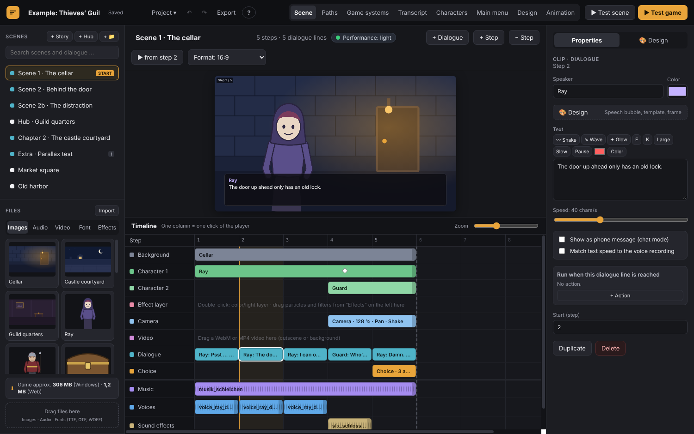

> **Status:** prototype (0.6.12). It works and is tested, but expect rough edges. Back up your projects.

## Download

Get the Windows version from the **[Releases](../../releases)** page: unzip the whole folder and start
`VN Timeline Engine.exe`. Because the program isn’t code-signed, Windows may show
“Windows protected your PC” → **More info** → **Run anyway**.

## Features

**Editor**
- Timeline with tracks for background, characters, effects, camera, video, dialogue, choices, music, voices and sound effects
- Paths view with all scenes and branches, chapters, search and a path check that finds dead ends
- Hub scenes (point & click places), conditions and actions everywhere (“If → Then”)
- Bones: animate a character from a single image (breathing, swaying, hair and wings with physics), blinking, lip sync
- Layer characters with expressions and outfits, animation editor for gestures and cutscenes
- Design: speech bubbles, buttons, windows, fonts, sounds, mouse cursor – right-click anything to restyle it
- Transcript with translations, CSV export/import, speaker script and subtitles
- Text import: paste finished dialogue (`Name: Text` or a Ren'Py script) and get clips, choices and scenes
- Tutorial project with a guided tour, and a “Learn” mode with 11 topics that check themselves off

**Game systems** – switch on only what your game needs
- Inventory, currencies & shops, loot tables, time & calendar, relationships with stages and gifts
- Achievements, gallery (CGs, music room, scene replay), stats, glossary, name input
- World & locations: world map with pins and submaps, home, events at locations, free time
- Quest log: quest series → quests → sections for the main story and every character, with designable notifications
- Skill trees paid with money, level-up points or custom points – effects on money, shops, relationships, jobs, travel, minigames and stats
- Turn-based combat in side view: party of up to four, levels, abilities, elements, loot, story mode, test battle and 100× simulation
- Building (idle): buildings produce resources, upgrades, goals that move the story forward, offline progress and a time preview
- Bundled plugins: Jobs and six minigames (click reflex, memory, puzzle, cooking & brewing, coin toss, petals)

**For players** (in every game automatically): history, auto mode, skip, save slots, quick save,
reading & accessibility options, graphics quality, sound output, language switch.

**Export:** Windows game with its own `.exe`, name and icon – or a web game for itch.io.

**Plugins:** add your own actions, conditions, menus, HUD elements, editor tabs and minigames in plain JavaScript.
See [`templates/PLUGINS.en.md`](templates/PLUGINS.en.md).

| | |
|---|---|
| 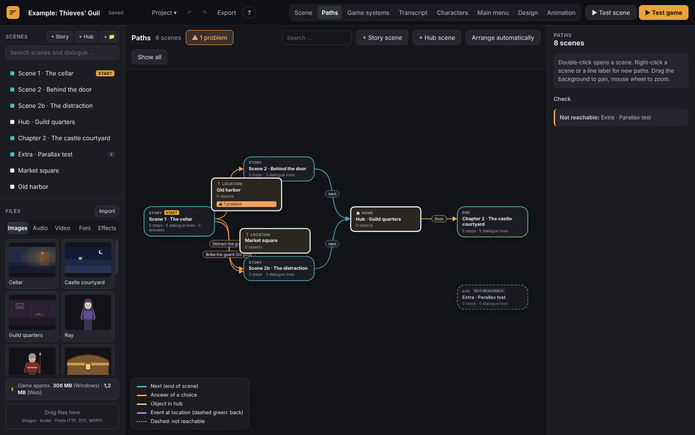 | 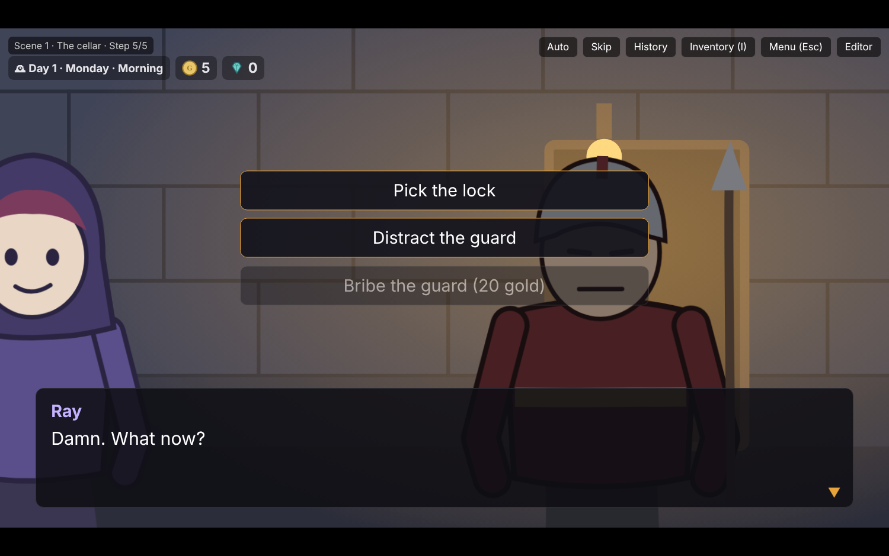 |
| 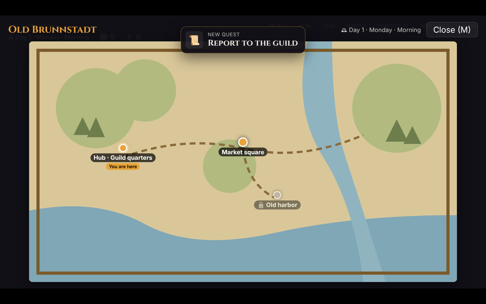 | 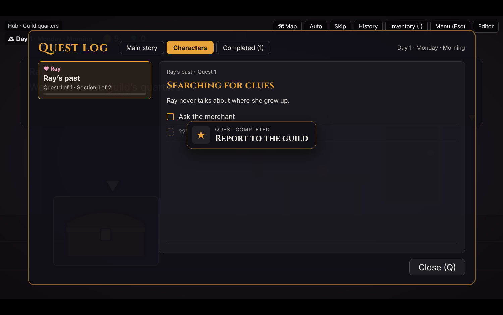 |
| 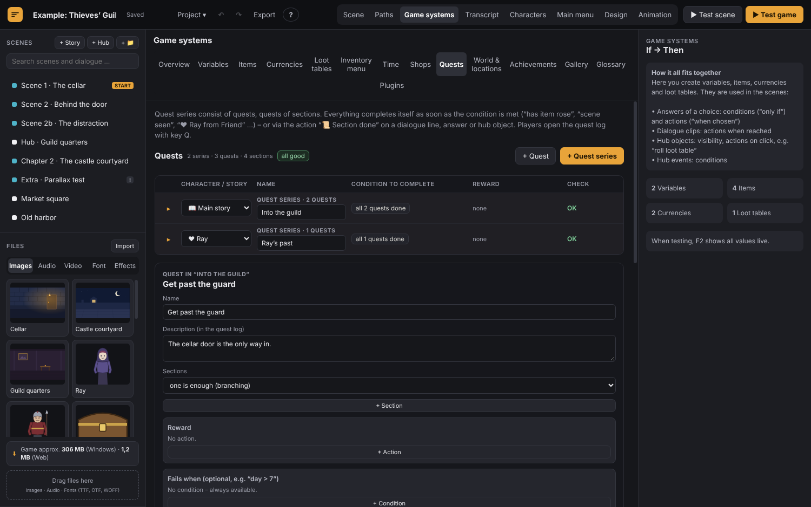 | 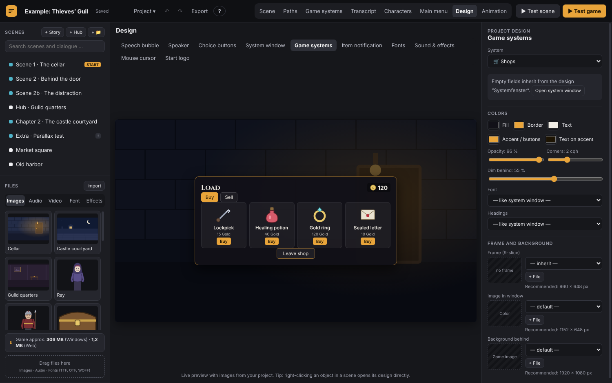 |
| 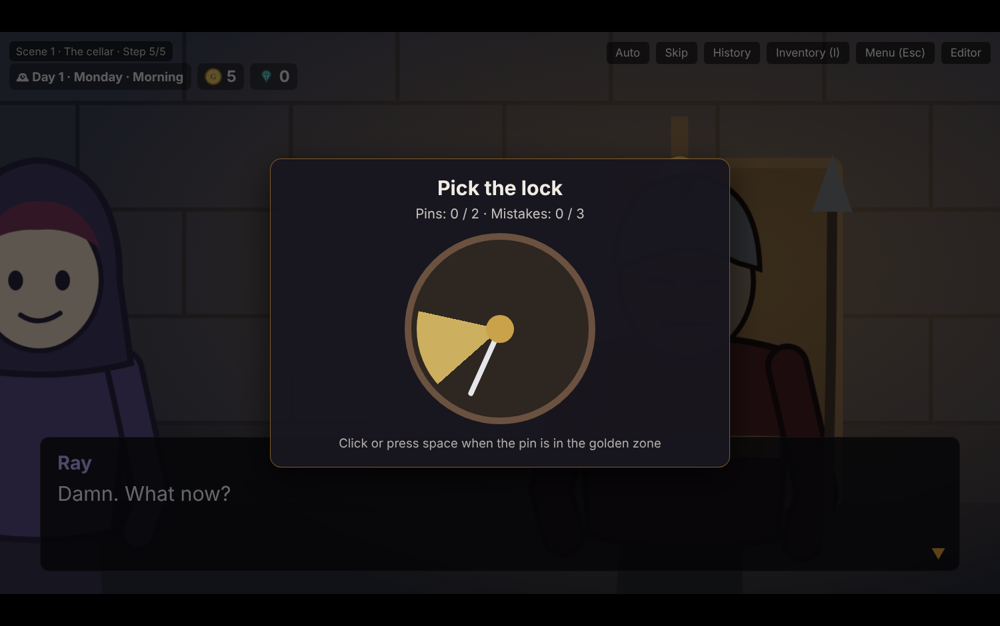 | 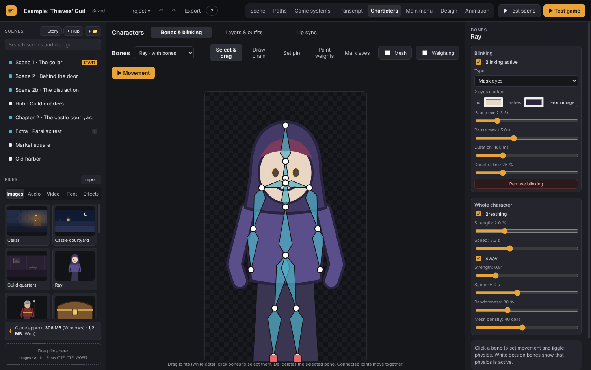 |

## Run from source

You need [Node.js](https://nodejs.org/) (version 20 or newer).

```bash
npm install
npm start
```

Build the Windows version:

```bash
npm run build:win
```

The result lands in `dist/`.

Run the test suite (13 projects from version 0.3 until today, opened, converted, played and exported):

```bash
npm test            # on Linux without a display: xvfb-run -a npm test
```

## Languages

The interface is available in **English** (default) and **German**. Switch on the start screen (top right) or under
**Project ▾ → Language**. The engine’s source texts are German; `renderer/js/i18n-en.js` holds the English
translation as a simple `"German": "English"` list – corrections and new languages are welcome.

Menus inside an exported game follow the game’s language: a German game gets German menus, any other language English ones.

## Project structure

```
main.js            Electron main process (files, export, security checks)
preload.js         Bridge between interface and main process
renderer/          Editor and player (plain JavaScript, no build step)
  js/i18n.js       Language switch and translator
  js/i18n-en.js    English translation
templates/         Bundled plugins, plugin guide, example font
demo.js            Example project · tutorial.js: tutorial project
tests/             Test suite and example projects from older versions
docs/screenshots/  Screenshots for this README
tools/             rcedit (sets the icon of exported games)
```

## License

MIT © 2026 The Talking Pegasus – see [LICENSE](LICENSE).
Third-party components: [THIRD_PARTY_NOTICES.md](THIRD_PARTY_NOTICES.md).

Games you make with VN Timeline Engine are yours. You can sell them, and you don’t have to publish their content.

---

<a id="deutsch"></a>

## Deutsch

**Visual Novels bauen wie im Schnittprogramm.** Bilder, Texte und Töne liegen als Clips auf einer Timeline –
jede Spalte ist ein Klick des Spielers. Kostenlos, Open Source (MIT), Oberfläche auf Deutsch und Englisch.

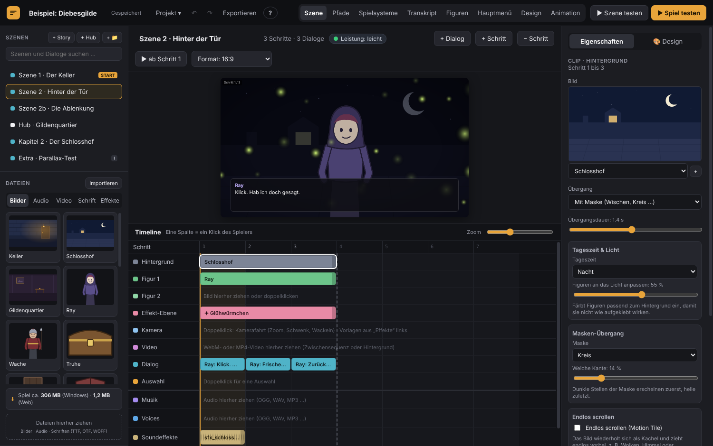

> **Stand:** Prototyp (0.6.12). Funktioniert und ist getestet, aber noch nicht in allem rund. Mach Sicherungen deiner Projekte.

### Herunterladen

Die Windows-Version gibt es unter **[Releases](../../releases)**: den ganzen Ordner entpacken und
`VN Timeline Engine.exe` starten. Weil das Programm nicht signiert ist, zeigt Windows evtl.
„Der Computer wurde durch Windows geschützt“ → **Weitere Informationen** → **Trotzdem ausführen**.

### Was drin ist

- **Editor:** Timeline mit Spuren für Hintergrund, Figuren, Effekte, Kamera, Video, Dialog, Auswahl, Musik, Stimmen und Sounds ·
  Pfade mit allen Szenen und Verzweigungen · Hub-Szenen · „Wenn → Dann“ überall · Bones-Animation aus einem einzigen Bild,
  Blinzeln, Lippensync · Ebenen-Figuren · Animations-Editor · Design per Rechtsklick · Transkript mit Übersetzungen ·
  Tutorial mit Tour und „Lernen“ mit 11 Themen
- **Spielsysteme (einzeln einschaltbar):** Inventar, Geld & Läden, Loot, Zeit & Kalender, Beziehungen mit Stufen und Geschenken,
  Erfolge, Galerie, Werte, Glossar, Welt & Orte mit Weltkarte, Questlog, Skilltrees, rundenbasierter Kampf, Aufbau (Idle), Jobs und sechs Minispiele
- **Für Spieler:** Verlauf, Auto, Skip, Spielstände, Schnellspeichern, Lesen & Barrierefreiheit, Grafikqualität, Tonausgabe
- **Export:** Windows-Spiel mit eigener `.exe` oder Web-Spiel für itch.io
- **Plugins** in einfachem JavaScript – Anleitung in [`templates/PLUGINS.md`](templates/PLUGINS.md)

| | |
|---|---|
| 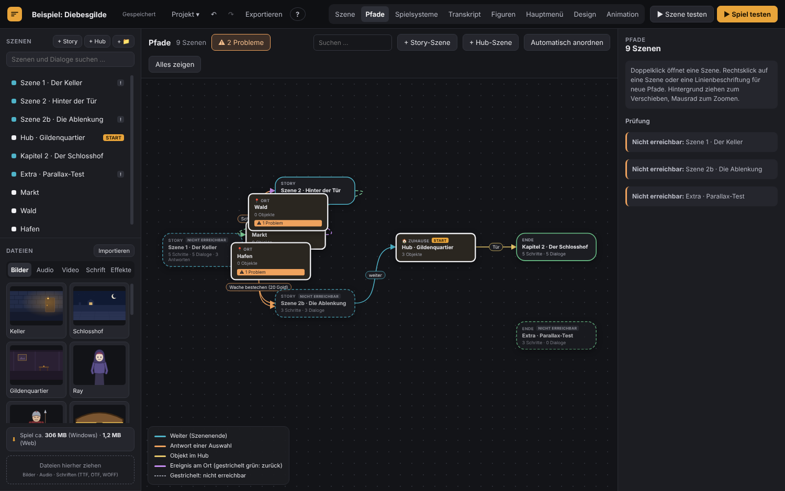 | 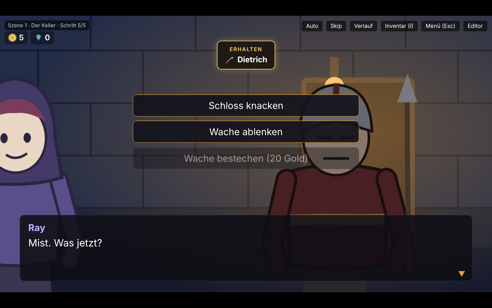 |
| 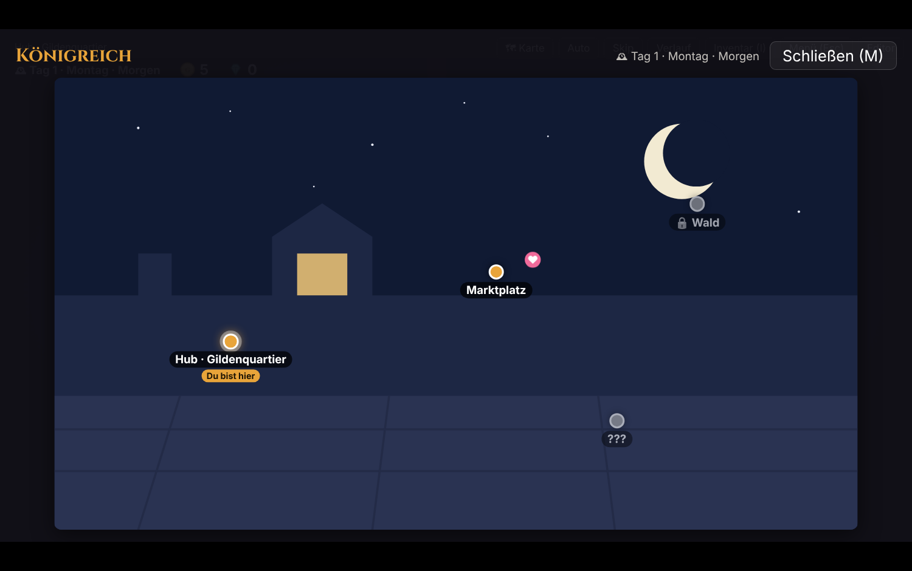 | 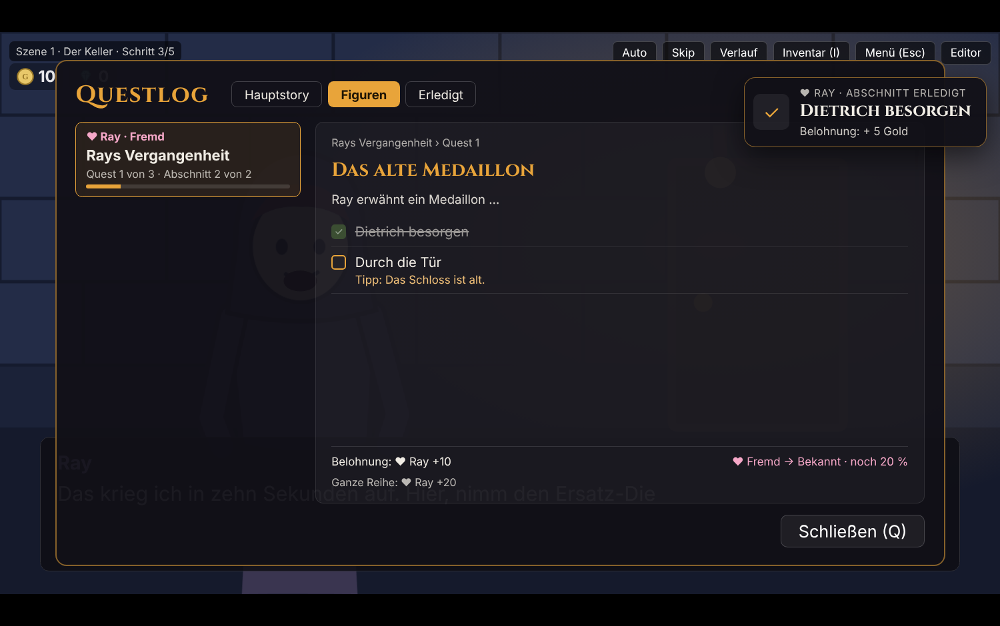 |

### Sprache

Englisch ist die Startsprache. Umschalten auf dem Startbildschirm (oben rechts) oder unter **Projekt ▾ → Sprache**.

### Aus dem Quellcode starten

[Node.js](https://nodejs.org/) (ab Version 20) installieren, dann:

```bash
npm install
npm start
```

Windows-Version bauen: `npm run build:win` (Ergebnis in `dist/`). Testreihe: `npm test`.

### Lizenz

MIT © 2026 The Talking Pegasus – siehe [LICENSE](LICENSE). Spiele, die du mit der Engine machst, gehören dir.
