# VN Timeline Engine

**Build visual novels like in a video editor.** Images, text and sound lie as clips on a timeline –
every column is one click of the player. Free, source available (VN Timeline Engine License), with an English, German, Spanish and Japanese interface.

🇩🇪 [Deutsche Beschreibung weiter unten](#deutsch)

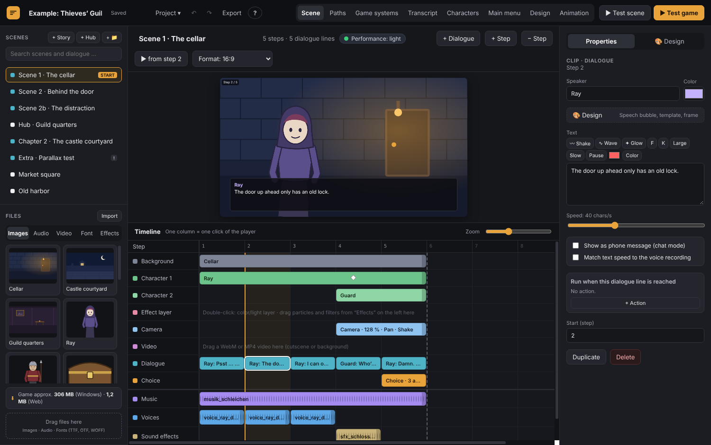

> **Status:** prototype (0.9.21). It works and is tested, but expect rough edges. Back up your projects.

## Try it in the browser

**[https://thetalkingpegasus.github.io/vn-timeline-engine/](https://thetalkingpegasus.github.io/vn-timeline-engine/)** – no installation. Projects are stored in your browser (or, in Chrome/Edge, in a folder
on your PC). Download them as a ZIP anytime and continue in the desktop version.

## Download

Get the Windows version from the **[Releases](../../releases)** page:
- **Recommended:** `VN-Timeline-Engine-Setup-<version>.exe` – installs with a desktop shortcut, and from then on
  updates arrive automatically (only the changes are downloaded).
- **Without installing:** the ZIP – unzip the whole folder and start `VN Timeline Engine.exe`.

Because the program isn’t code-signed, Windows may show “Windows protected your PC” → **More info** → **Run anyway**.

## Features

**Editor**
- Timeline with tracks for background, characters, effects, camera, video, dialogue, choices, code, music, voices and sound effects
- **Code track and formulas:** small commands that run at a step (`gold += 5`, `if courage > 3: points += 1`, `give("Key")`,
  `goto("Market")`), the same as an action anywhere and as a condition (`gold >= 10 and item("Key") > 0`) – with live error
  check and one-click variables
- **Lights and filters:** spotlight, lamp, neon tube and backlight with rim light on characters, haze and dust in the beam,
  flicker and sweep, also in hubs and with parallax · CRT TV, LCD TV and RGB split filters
- Paths view with all scenes and branches, chapters, search and a path check that finds dead ends
- Hub scenes (point & click places) with clickable objects (also invisible hitboxes), backgrounds per time of day,
  particles, events (“when” and “how often”) and hub dialogues – full timeline scenes that play over the hub and come back
- Conditions and actions everywhere (“If → Then”), choices that grey out or hide what was already asked, placed anywhere
- Bones: animate a character from a single image (breathing, swaying, hair and wings with physics), blinking, lip sync,
  editable mesh – also for layered characters with outfits
- Jointed puppets: build a character from body parts like in After Effects – pins as joints, bones per part, idle motion
  (breathing, jiggle, sway), a “Human” template, joint limits, **seams** that bend parts together without cracks,
  **hold points** (pin a hand or foot and the body bends around it), an inpaint brush for gaps, an eraser, folders for
  parts, and puppet-style posing in the animation editor
- Animation editor for idle, gestures and cutscenes with **frame rates** (smooth, 24, on twos, on threes) and cartoon
  **smear frames** on fast motion; a **curve graph** with Bézier handles smooths every transition between keyframes
- **Pixel art editor** (Design → 🎨 Pixel art): draw and animate frame by frame with layers, palettes, onion skin and
  mirroring – finished animations become pixel-sharp animated GIFs you can use as characters, backgrounds, hub objects or fighters
- Layer characters with expressions and outfits, animation editor for gestures and cutscenes
- Storyboard planning board, asset folders, copy & paste clips between scenes, copy a character’s format, free transform with snapping
- Spell-check suggestions on right-click, colour-blind preview for the editor
- Design: speech bubbles, buttons, windows, fonts, sounds, mouse cursor – right-click anything to restyle it
- Transcript with translations, CSV export/import, speaker script and subtitles
- Text import: paste finished dialogue (`Name: Text` or a Ren'Py script) and get clips, choices and scenes
- Tutorial project with a guided tour, and a “Learn” mode with 11 topics that check themselves off

**Game systems** – switch on only what your game needs
- Inventory, currencies & shops, loot tables, time & calendar, relationships with stages and gifts
- Achievements, gallery (CGs, music room, scene replay), stats, glossary, name input
- World & locations: world map with pins and submaps, home, events at locations, free time, places that unlock “if …”,
  lock while a condition holds or disappear for good
- Quest log: quest series → quests → sections for the main story and every character, with designable notifications
- Skill trees paid with money, level-up points or custom points – effects on money, shops, relationships, jobs, travel, minigames and stats
- Turn-based combat in side view: party of up to four, levels, abilities, elements, loot, story mode, test battle and 100× simulation –
  fighters with bones or jointed puppets get their own idle, attack, spell, hit, K.O. and victory animations that blend smoothly
- Building (idle): buildings produce resources, upgrades, goals that move the story forward, offline progress and a time preview
- Equipment: wear items in slots (head, body, hand …) with bonuses and actions
- **Devices:** an in-game phone or computer (desktop with windows and taskbar) with apps – messages, inventory,
  relationships, gallery, quests, map … and your own apps (notes, mails, websites). Fully designable, optional PIN or password
- **Social media app:** characters post pictures and text, posts appear through conditions or actions, the player likes
  and comments, and follower counts grow with the story
- **Messages that persist across scenes:** contacts, conversations with different lines per story route, replies the
  player picks, hidden messages, messages only for the phone or only for the computer, and messages that unlock
  locations, items or quests when read
- Time of day, seasons and ambient sounds; game over screen with retry
- Bundled plugins: Jobs and eleven minigames (click reflex, memory, puzzle, cooking & brewing, coin toss, petals,
  quicktime circle, safe, pipes, barbell, dumbbells) – minigames can be won or lost and made easier with skill tree perks or equipment
- **Arcade:** darts, pool, blackjack and a slot machine – darts and pool against computer opponents whose accuracy,
  tactics and thinking time you set; board, table, balls, cards, reels and cabinet designable with your own images
- More minigames: **safe / combination lock** (dial, keypad or wheels, code from the story or random) and **connect
  the pipes** (always solvable, water, cables or magic runes)
- Fitness minigames: **barbell** (mash the space bar until the bar reaches the line) and **dumbbells** (a rhythm game –
  left and right move to their own beat, press A or D when a dumbbell is up in the zone); weights, background and colours designable

**For players** (in every game automatically): history, auto mode, skip, save slots, quick save,
reading & accessibility options, graphics quality, sound output, language switch.

**Export:** Windows game with its own `.exe`, name and icon – or a web game for itch.io. Game files can stay open (easy
modding), be packed into one encrypted file, or be packed with a `mods` folder that overrides files.

**Plugins:** add your own actions, conditions, menus, HUD elements, editor tabs and minigames in plain JavaScript.
See [`templates/PLUGINS.en.md`](templates/PLUGINS.en.md).

**Working with AI assistants:** [`docs/AI-GUIDE.md`](docs/AI-GUIDE.md) explains the project format, all conditions and
actions and how to operate the program, so any AI (ChatGPT, Gemini, Grok, Claude …) can edit projects without the
engine source code. Inside the engine, *Project ▾ → 🤖 Guide for AI* creates the same guide with an overview of your project.

| | |
|---|---|
| 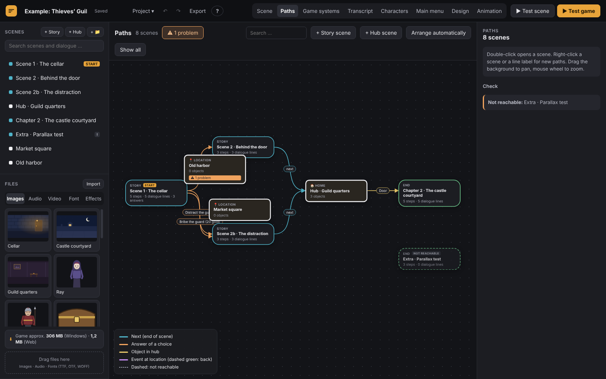 | 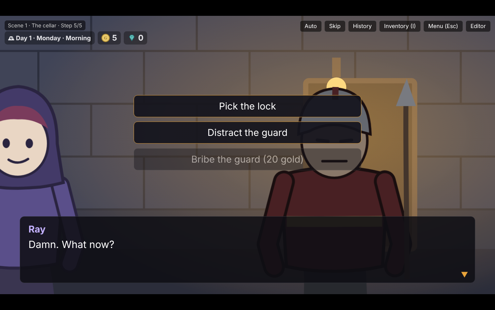 |
| 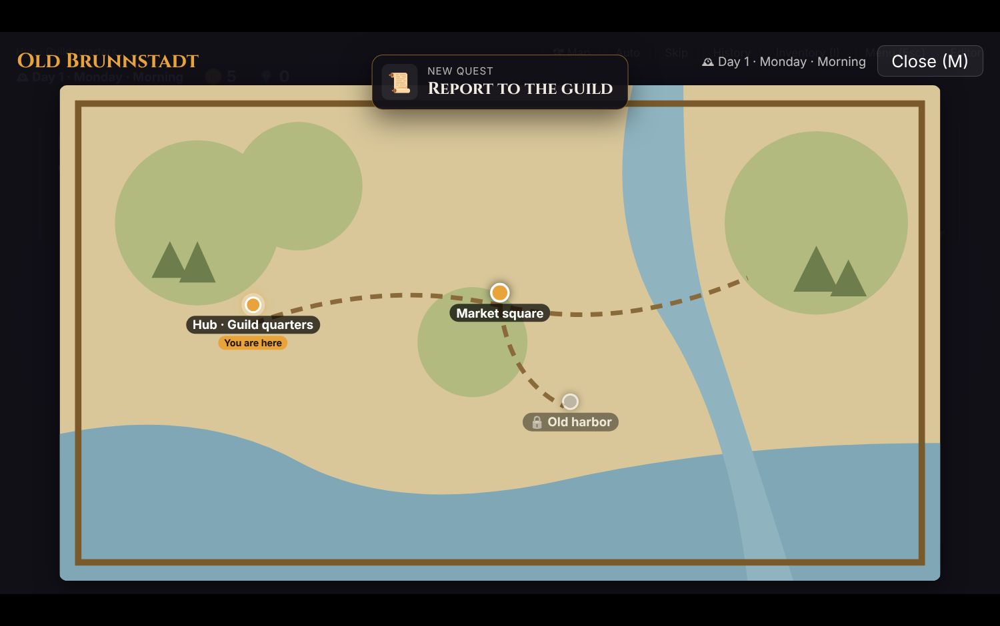 | 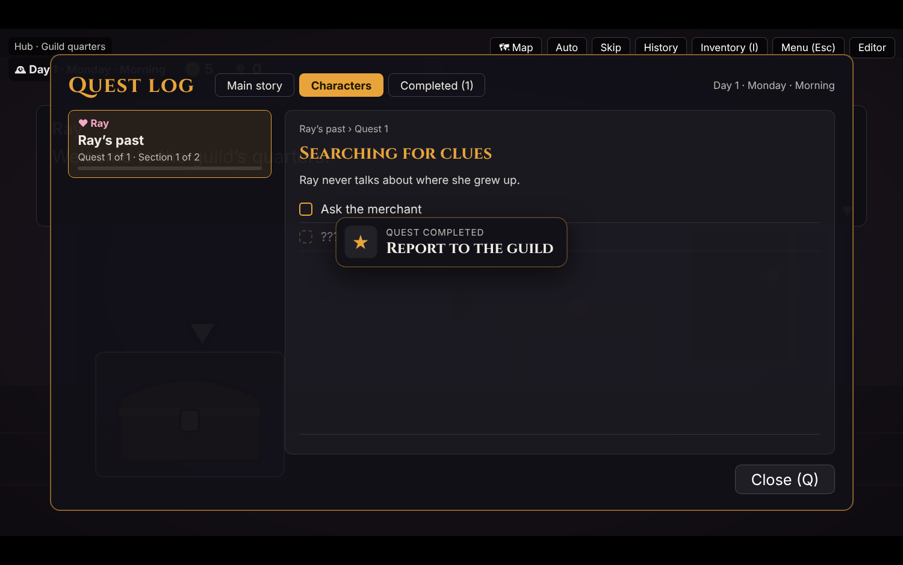 |
| 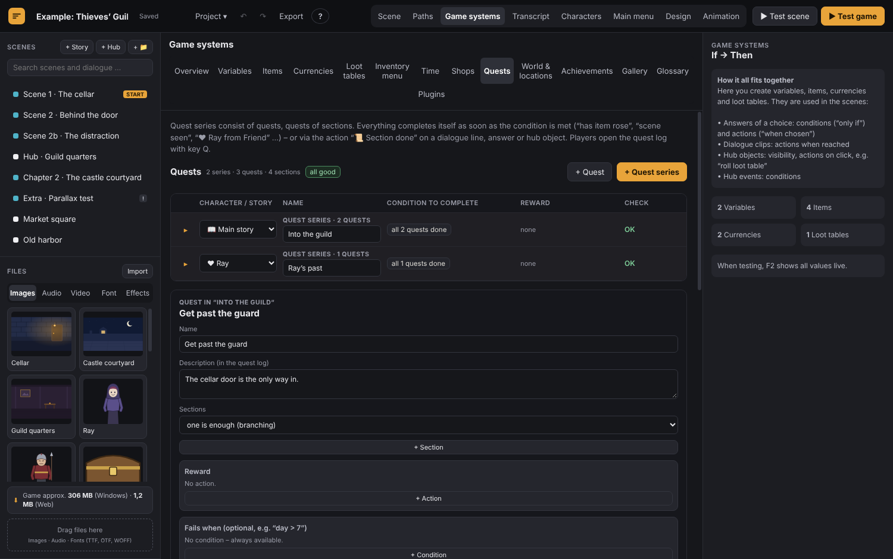 | 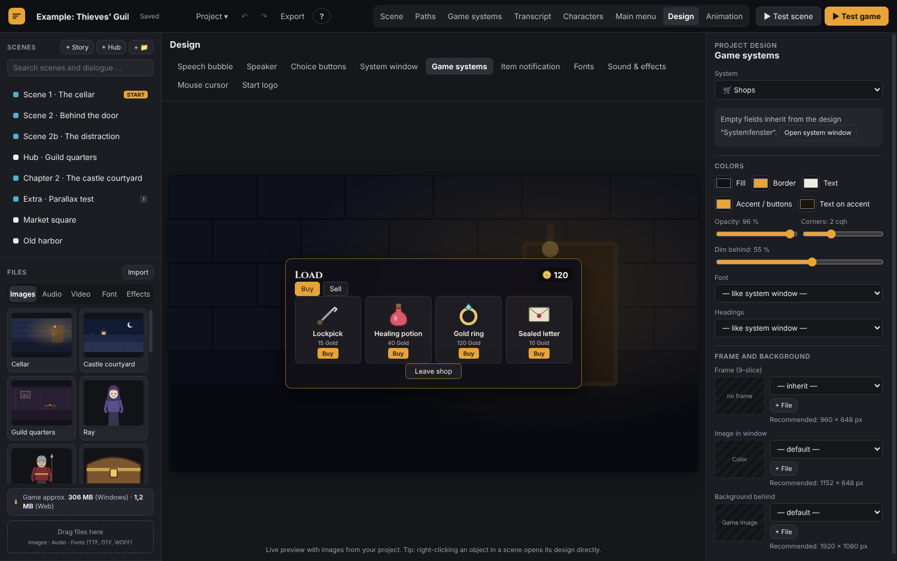 |
| 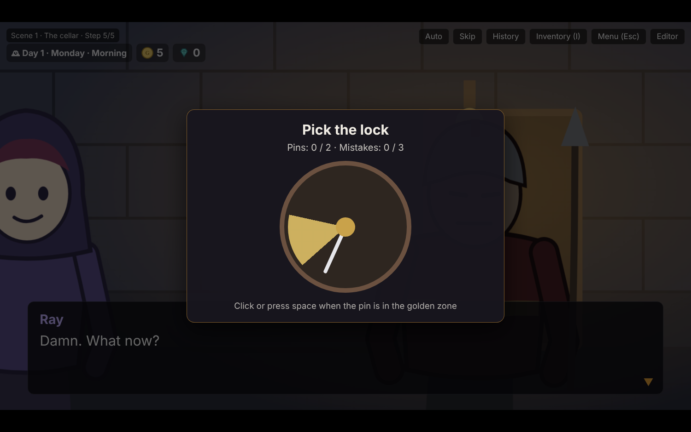 | 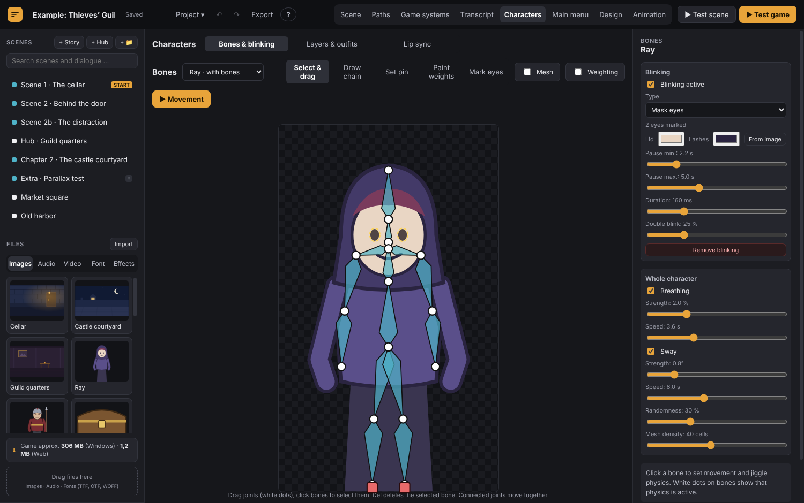 |
| 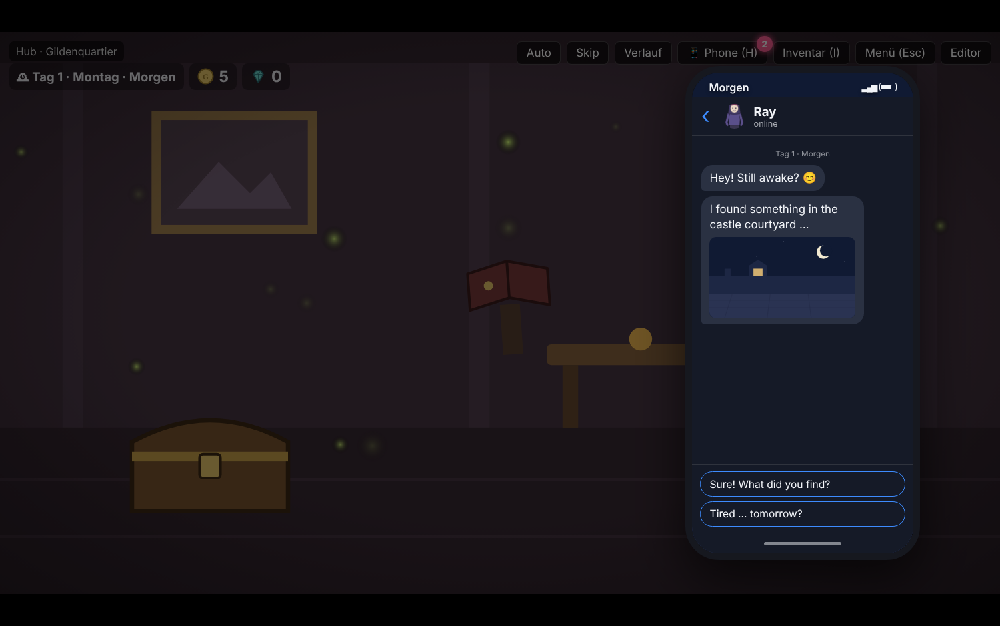 | 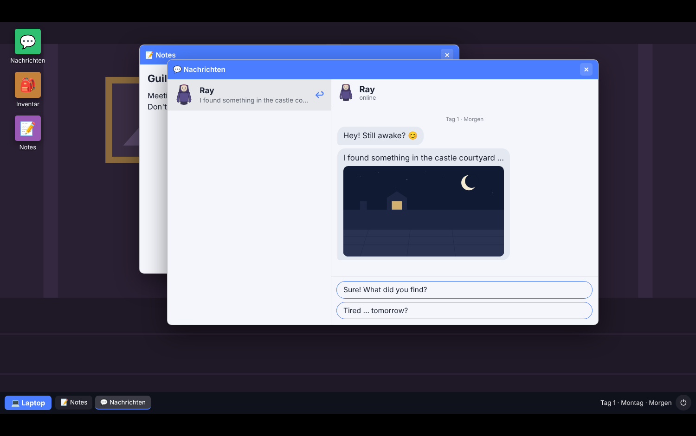 |
| 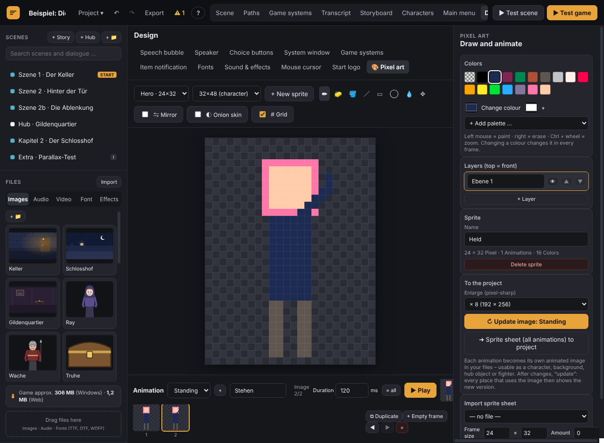 | 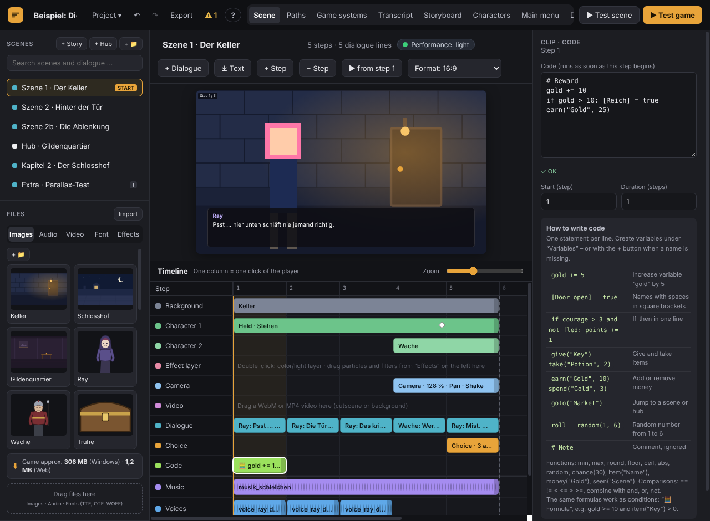 |

## Run from source

You need [Node.js](https://nodejs.org/) (version 20 or newer).

```bash
npm install
npm start
```

Build the Windows version:

```bash
npm run build:win
```

The result lands in `dist/`.

Run the test suite (16 projects from version 0.3 until today, opened, converted, played and exported):

```bash
npm test            # on Linux without a display: xvfb-run -a npm test
```

## Languages

The interface is available in **English** (default), **German**, **Spanish** and **Japanese**. Switch on the start screen
or under **Project ▾ → Language**. The engine’s source texts are German; `renderer/js/i18n-en.js`, `i18n-es.js` and
`i18n-ja.js` hold the translations as simple `"German": "translation"` lists (a text missing in Spanish or Japanese
falls back to English) – corrections and new languages are welcome.

Menus inside an exported game follow the game’s language: German, English, Spanish or Japanese menus, English for any other language.

## Project structure

```
main.js            Electron main process (files, export, security checks)
project-lang.js    Translated dialogs and example projects (main process and web build)
preload.js         Bridge between interface and main process
renderer/          Editor and player (plain JavaScript, no build step)
  js/i18n.js       Language switch and translator
  js/i18n-en.js    English translation (i18n-es.js Spanish, i18n-ja.js Japanese)
templates/         Bundled plugins, plugin guide, example font
demo.js            Example project · tutorial.js: tutorial project
tests/             Test suite and example projects from older versions
docs/AI-GUIDE.md   Guide for AI assistants (generated by the engine)
docs/screenshots/  Screenshots for this README
tools/             rcedit (sets the icon of exported games), build-web.js (web version → web-build/)
```

## License

VN Timeline Engine License 1.0 © 2026 The Talking Pegasus – see [LICENSE](LICENSE) (German: [LIZENZ.txt](LIZENZ.txt)). Free to use, change and make games with; games you make are yours and may be sold. The engine itself may not be sold or passed off as your own. Versions up to 0.6.12 remain under the MIT License.
Third-party components: [THIRD_PARTY_NOTICES.md](THIRD_PARTY_NOTICES.md).

Games you make with VN Timeline Engine are yours. You can sell them, and you don’t have to publish their content.

---

<a id="deutsch"></a>

## Deutsch

**Visual Novels bauen wie im Schnittprogramm.** Bilder, Texte und Töne liegen als Clips auf einer Timeline –
jede Spalte ist ein Klick des Spielers. Kostenlos, Quellcode einsehbar (VN Timeline Engine Lizenz), Oberfläche auf Deutsch, Englisch, Spanisch und Japanisch.

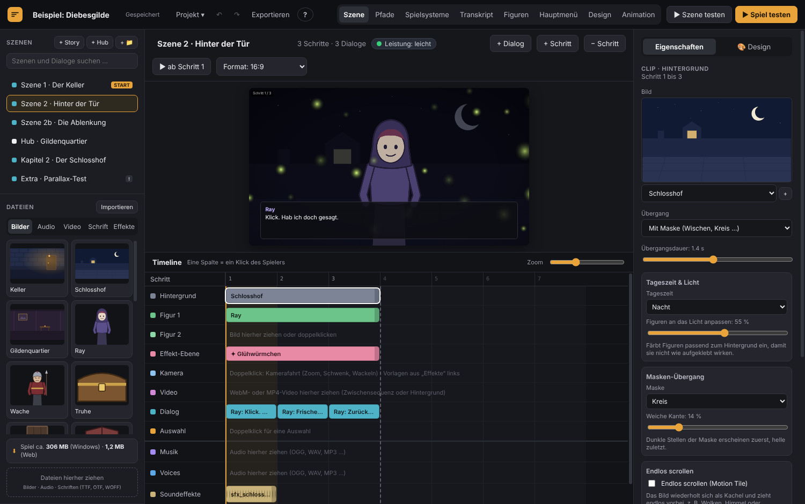

> **Stand:** Prototyp (0.9.21). Funktioniert und ist getestet, aber noch nicht in allem rund. Mach Sicherungen deiner Projekte.

### Im Browser ausprobieren

**[https://thetalkingpegasus.github.io/vn-timeline-engine/](https://thetalkingpegasus.github.io/vn-timeline-engine/)** – ohne Installation. Projekte liegen im Browser (oder in Chrome/Edge in einem Ordner auf dem PC)
und lassen sich jederzeit als ZIP herunterladen und in der Desktop-Version weiterbearbeiten.

### Herunterladen

Die Windows-Version gibt es unter **[Releases](../../releases)**:
- **Empfohlen:** `VN-Timeline-Engine-Setup-<Version>.exe` – installiert mit Desktop-Verknüpfung, danach kommen Updates
  automatisch (es werden nur die Änderungen geladen).
- **Ohne Installation:** die ZIP – den ganzen Ordner entpacken und `VN Timeline Engine.exe` starten.

Weil das Programm nicht signiert ist, zeigt Windows evtl. „Der Computer wurde durch Windows geschützt“ →
**Weitere Informationen** → **Trotzdem ausführen**.

### Was drin ist

- **Editor:** Timeline mit Spuren für Hintergrund, Figuren, Effekte, Kamera, Video, Dialog, Auswahl, Code, Musik, Stimmen und Sounds ·
  Pfade mit allen Szenen und Verzweigungen · Hub-Szenen mit Objekten (auch unsichtbare Hitboxen), Hintergrund je Tageszeit,
  Partikeln, Ereignissen („wann“ und „wie oft“) und Hub-Dialogen · „Wenn → Dann“ überall · Auswahl, die Gefragtes ausgraut
  oder ausblendet und sich frei platzieren lässt · Bones-Animation aus einem einzigen Bild, Blinzeln, Lippensync,
  bearbeitbares Gitter – auch für Ebenen-Figuren mit Outfits · **Gliederpuppen** aus Körperteilen wie in After Effects
  (Pins als Gelenke, Bones je Teil, Idle, Vorlage „Mensch“, Gelenk-Grenzen, **Nähte** ohne Risse, **Haftpunkte**,
  Inpaint-Stift für Lücken, Radierer, Ordner, Puppenspiel im Animations-Editor) · Ebenen-Figuren · Storyboard · Medien-Ordner · Clips zwischen Szenen kopieren · Format kopieren ·
  Frei transformieren · Rechtschreib-Vorschläge · Design per Rechtsklick · Transkript mit Übersetzungen ·
  Tutorial mit Tour und „Lernen“ mit 11 Themen
- **Code-Spur und Formeln:** kleine Befehle an einem Schritt (`gold += 5`, `if mut > 3: punkte += 1`, `give("Schlüssel")`,
  `goto("Marktplatz")`), dasselbe als Aktion überall und als Bedingung (`gold >= 10 and item("Schlüssel") > 0`) – mit
  Fehlerprüfung beim Tippen und Variablen per Klick
- **Licht und Filter:** Scheinwerfer, Lampe, Neonröhre und Gegenlicht mit Randlicht auf Figuren, Dunst und Staub im Strahl,
  Flackern und Schwenken, auch in Hubs und mit Parallax · Röhren-TV, LCD-TV und RGB-Split
- **Animation:** Idle, Gesten und Zwischensequenzen mit **Bildrate** (flüssig, 24, auf Zweiern, auf Dreiern) und
  Cartoon-**Smear-Bildern** bei schnellen Bewegungen; ein **Kurven-Graph** mit Bézier-Griffen macht jeden Übergang
  zwischen Keyframes weich
- **Pixel-Art-Editor** (Design → 🎨 Pixel-Art): Bild für Bild zeichnen und animieren mit Ebenen, Paletten, Zwiebelhaut und
  Spiegeln – fertige Animationen werden pixelscharfe animierte GIFs für Figuren, Hintergründe, Hub-Objekte oder Kämpfer
- **Spielsysteme (einzeln einschaltbar):** Inventar, Geld & Läden, Loot, Zeit & Kalender mit Jahreszeiten und Ambient-Sounds,
  Beziehungen mit Stufen und Geschenken, Erfolge, Galerie, Werte, Glossar, Welt & Orte mit Weltkarte (Orte „wenn …“
  freischalten, zeitweise sperren oder für immer entfernen), Questlog, Skilltrees, rundenbasierter Kampf (Kämpfer mit Bones
  oder Gliederpuppe bekommen eigene Idle-, Angriffs-, Treffer-, K.O.- und Sieg-Animationen mit weicher Überblendung),
  Aufbau (Idle), Ausrüstung, Game Over, Jobs und elf Minispiele (auch verlierbar, mit Perks leichter)
- **Spielhalle:** Dart, Billard, Blackjack und Spielautomat – Dart und Billard gegen Computer-Gegner mit einstellbarer
  Treffsicherheit, Taktik und Bedenkzeit; Scheibe, Tisch, Kugeln, Karten, Walzen und Gehäuse mit eigenen Bildern
- Weitere Minispiele: **Tresor / Zahlenschloss** (Drehrad, Tastenfeld oder Rädchen, Code aus der Geschichte oder
  zufällig) und **Rohre verbinden** (immer lösbar, als Wasser, Kabel oder magische Runen)
- Fitness-Minispiele: **Langhantel** (Leertaste hämmern, bis die Hantel die Ziellinie erreicht) und **Kurzhanteln**
  (Rhythmusspiel – links und rechts im eigenen Takt, A oder D drücken, wenn eine Hantel oben in der Zone ist)
- **Geräte:** Handy oder Computer im Spiel mit Apps (Nachrichten, Inventar, Beziehungen, Galerie, Quests, Karte … und eigene
  Apps), komplett gestaltbar, auf Wunsch mit PIN oder Passwort · **Nachrichten über Szenen hinweg** mit Kontakten,
  Routen-Varianten, Antworten zum Auswählen, versteckten Nachrichten, Nachrichten nur fürs Handy oder nur für den PC –
  und Nachrichten, die beim Lesen Orte, Gegenstände oder Quests freischalten
- **Social-Media-App:** Figuren posten Bilder und Text, Beiträge erscheinen über Bedingungen oder Aktionen, der Spieler
  liked und kommentiert, und die Follower wachsen mit der Story
- **Für Spieler:** Verlauf, Auto, Skip, Spielstände, Schnellspeichern, Lesen & Barrierefreiheit, Grafikqualität, Tonausgabe
- **Export:** Windows-Spiel mit eigener `.exe` oder Web-Spiel für itch.io – Spieldateien offen (gut zum Modden), gepackt in
  einer verschlüsselten Datei oder gepackt mit `mods`-Ordner
- **Plugins** in einfachem JavaScript – Anleitung in [`templates/PLUGINS.md`](templates/PLUGINS.md)
- **Mit KI arbeiten:** [`docs/AI-GUIDE.md`](docs/AI-GUIDE.md) erklärt Projektformat, alle Bedingungen und Aktionen und die Bedienung – so kann jede KI Projekte ohne Quellcode bearbeiten. In der Engine: *Projekt ▾ → 🤖 Anleitung für KI* (mit Übersicht deines Projekts).

| | |
|---|---|
| 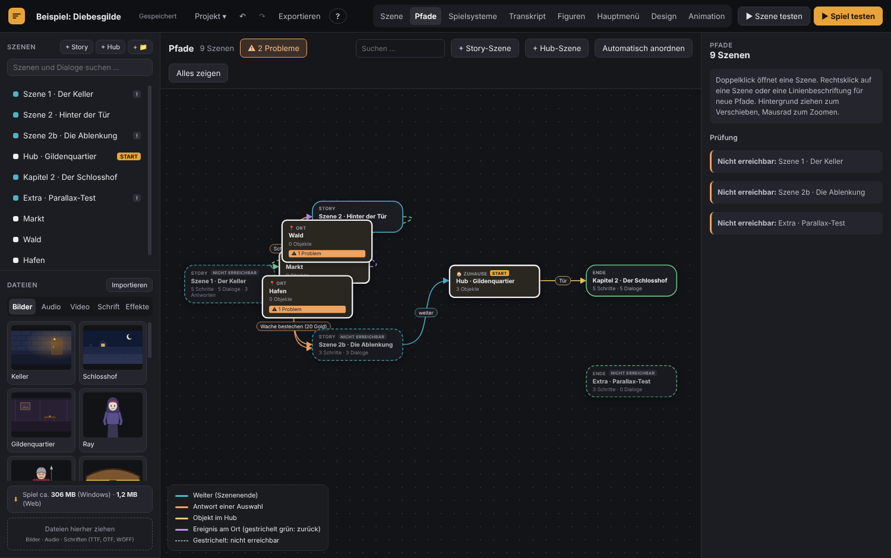 | 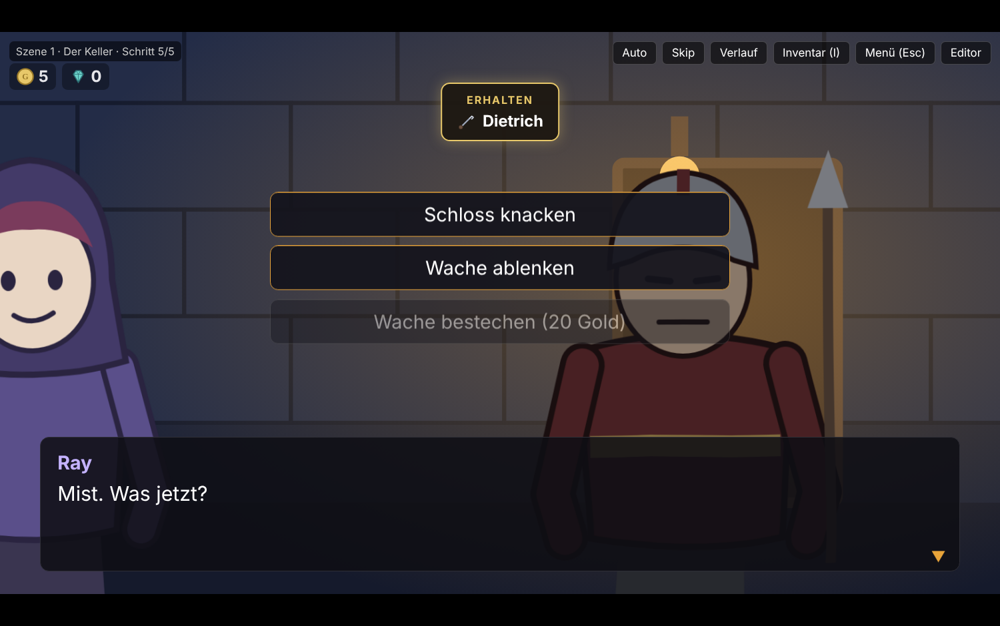 |
| 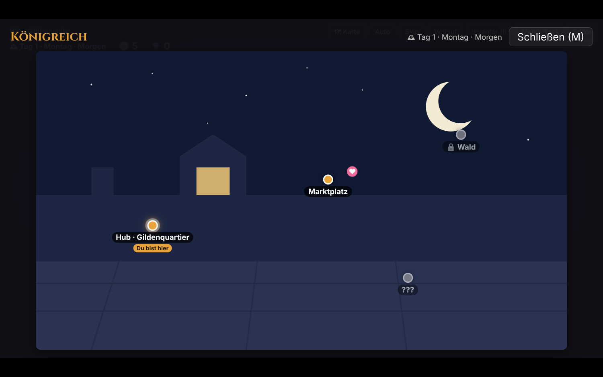 | 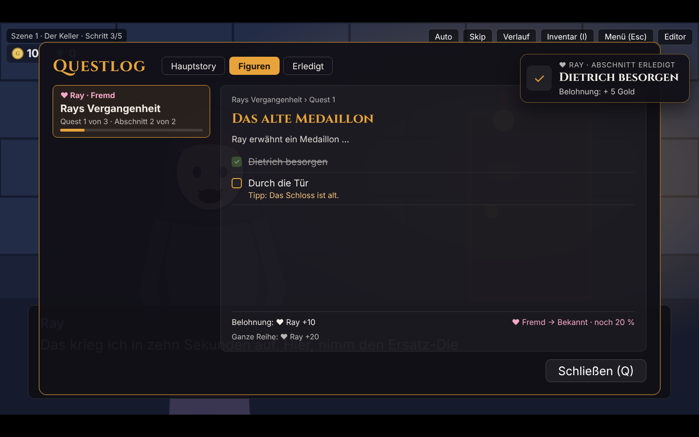 |
| 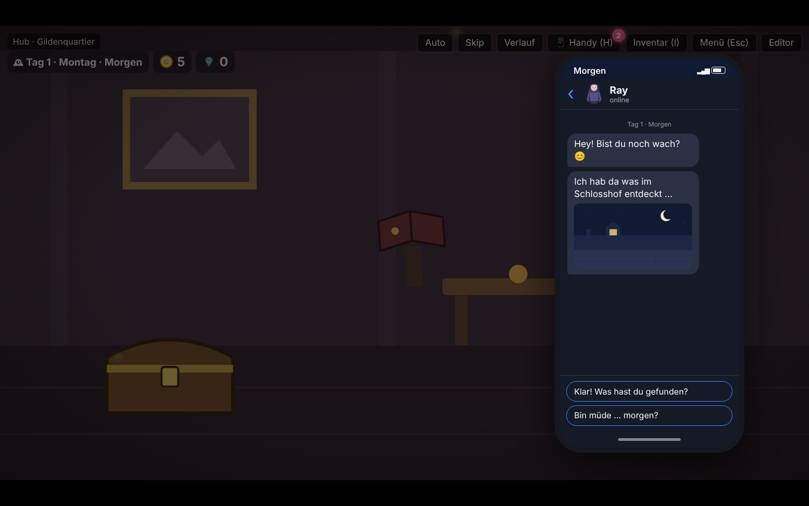 | 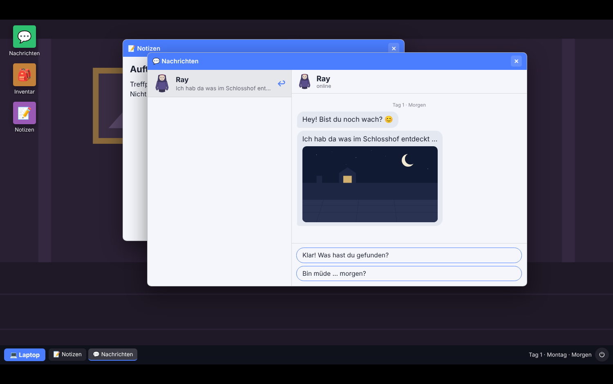 |
| 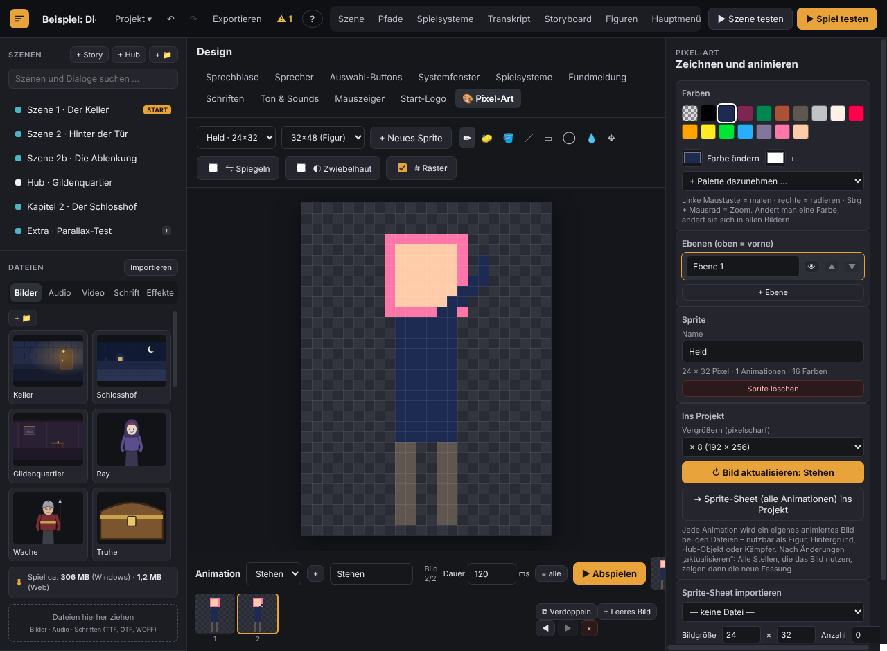 | 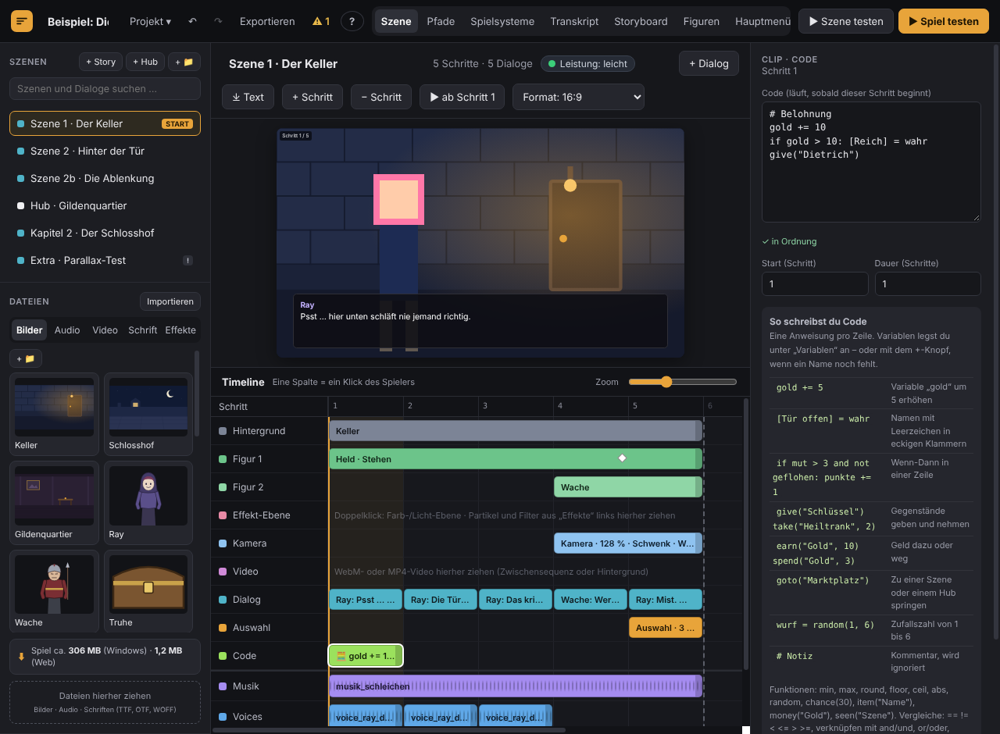 |

### Sprache

Englisch ist die Startsprache, außerdem gibt es Deutsch, Spanisch und Japanisch. Umschalten auf dem Startbildschirm oder unter **Projekt ▾ → Sprache**.

### Aus dem Quellcode starten

[Node.js](https://nodejs.org/) (ab Version 20) installieren, dann:

```bash
npm install
npm start
```

Windows-Version bauen: `npm run build:win` (Ergebnis in `dist/`). Testreihe: `npm test`.

### Lizenz

VN Timeline Engine Lizenz 1.0 © 2026 The Talking Pegasus – siehe [LIZENZ.txt](LIZENZ.txt) (englisch: [LICENSE](LICENSE)). Spiele, die du mit der Engine machst, gehören dir und dürfen verkauft werden. Die Engine selbst darf nicht verkauft oder als eigenes Werk ausgegeben werden. Versionen bis 0.6.12 bleiben unter der MIT-Lizenz.
